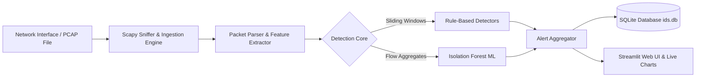

# 🛡️ Real-Time Network Anomaly Detection System (NIDS)

A hybrid **Rule-Based & Machine Learning-driven Network Intrusion Detection System (NIDS)** equipped with real-time packet inspection, automated attack detection, SQLite forensic logging, and an interactive **Streamlit Security Operations Dashboard**.

[](https://www.python.org/)
[](https://streamlit.io/)
[](https://scapy.net/)
[](https://opensource.org/licenses/MIT)

---

## 📌 Overview

Modern enterprise networks face rapid and sophisticated cyber-attacks ranging from subtle reconnaissance scans to volumetric Denial-of-Service (DoS) and protocol poisoning. This project delivers an end-to-end network security monitoring platform combining:

1. **Deterministic Rule-Based Detectors**: Protocol-level sliding window heuristics for deterministic, zero-latency detection of known cyber attacks.
2. **Unsupervised Machine Learning**: Scikit-Learn **Isolation Forest** trained on flow-window aggregates to discover evasive and zero-day anomalous behaviors (e.g., slow evasive scans).
3. **Live Packet Capture & PCAP Forensics**: Multi-threaded packet ingestion supporting both real-time interface sniffing (via **Npcap / Scapy**) and offline PCAP uploads.
4. **Interactive SecOps Dashboard**: Real-time traffic analytics, severity-ranked alert feeds, interactive Plotly charts, and historical alert databases.

---

## 🚀 Key Features

- **⚡ Dual-Engine Detection Pipeline**:
  - High-precision protocol rule matching (SYN flags, ARP bindings, ICMP sweeps, DNS AXFR, FTP 530 codes).
  - Unsupervised outlier scoring via Isolation Forest on sliding 5-second traffic windows.
- **🔴 Real-Time Sniffing**:
  - Native Windows Npcap support with intelligent adapter filtering (Ethernet, Wi-Fi, Loopback).
  - Thread-safe packet processing queue designed to prevent packet loss.
- **📊 Security Analytics Dashboard**:
  - Real-time protocol distribution (TCP, UDP, ICMP, ARP, DNS, DHCP, FTP, HTTP/TLS).
  - Dynamic traffic timeline with overlaid attack triggers.
  - Live alerts table with severity categorization (`CRITICAL`, `HIGH`, `MEDIUM`).
- **💾 SQLite Alert Persistence**:
  - Persistent database (`data/ids.db`) logging timestamp, source/destination IPs, attack category, severity, and event details.
  - CSV export for security audits.

---

## 🎯 Threat Detection Matrix

| Attack Vector | Protocol / Target | Detection Heuristic | Severity |
|---|---|---|---|
| **Port Scan** | TCP (SYN without Handshake) | $\ge 20$ distinct destination ports probed within $5.0\text{ s}$ | `HIGH` |
| **Ping Sweep** | ICMP (Type 8 Echo Request) | $\ge 10$ unique destination hosts pinged within $10.0\text{ s}$ | `MEDIUM` |
| **ARP Spoofing** | ARP (Reply Poisoning) | IP-to-MAC mapping conflict detected in unsolicited replies | `CRITICAL` |
| **DNS Enumeration** | DNS (Port 53 UDP) | $\ge 30$ unique subdomains queried within $10.0\text{ s}$ | `MEDIUM` |
| **Zone Transfer (AXFR)** | DNS (Port 53 TCP) | TCP AXFR request (QTYPE 252) query interception | `HIGH` |
| **FTP Brute Force** | FTP (Port 21) | $\ge 5$ consecutive `530 Login incorrect` responses within $60.0\text{ s}$ | `HIGH` |
| **SYN Flood DoS** | TCP | $\ge 100\text{ SYN packets/second}$ without completed handshakes | `CRITICAL` |
| **Rogue DHCP Server** | DHCP (UDP 67/68) | DHCP `OFFER` originating from an unapproved server MAC | `CRITICAL` |
| **Evasive / Slow Scans** | Any Protocol | Isolation Forest multi-feature anomaly scoring | `ANOMALY` |

---

## 🏗️ System Architecture



---

## 📁 Repository Structure

```text
cbp_network_anomaly_project/
├── .gitignore                     # Git ignore rules for Python & temp files
├── README.md                      # Project documentation
└── cbp_network_anomaly/
    ├── dashboard/
    │   └── app.py                 # Streamlit Security Operations Dashboard
    ├── data/
    │   └── ids.db                 # Persistent SQLite alerts database
    ├── figs/                      # Generated evaluation charts & topology diagrams
    ├── pcaps/                     # Attack test capture files (.pcap)
    ├── results/                   # Benchmark CSVs, baseline metrics, test logs
    └── src/
        ├── capture.py             # Live packet sniffer (Npcap / Scapy)
        ├── db.py                  # SQLite alerts storage & query helpers
        ├── detectors.py           # Protocol-level rule-based anomaly detectors
        ├── evaluate.py            # Comprehensive evaluation & benchmarking pipeline
        ├── gen_pcaps.py           # Synthetic benign & attack traffic generator
        ├── ml_iforest.py          # Isolation Forest unsupervised ML detector
        ├── notifier.py            # Alert notifications & formatting
        ├── parser.py              # Scapy packet to Pandas DataFrame parser
        └── run_detector.py        # CLI detection runner
```

---

## ⚙️ Installation & Setup

### 1. Prerequisites
- **Python**: Version 3.9 or newer.
- **Npcap (Windows)**: Required for live packet capture.
  - Download and install from [npcap.com](https://npcap.com).
  - During installation, check **"Install Npcap in WinPcap API-compatible Mode"**.

### 2. Clone the Repository
```bash
git clone https://github.com/bvdpreddybode-commits/Network-Anamoly-Detection.git
cd Network-Anamoly-Detection/cbp_network_anomaly
```

### 3. Install Dependencies
```bash
pip install -r requirements.txt
# Or install core packages directly:
pip install scapy pandas numpy scikit-learn streamlit plotly
```

---

## 🖥️ Running the Application

### Launch the Security Dashboard
Run Streamlit from the `cbp_network_anomaly` directory:

```bash
streamlit run dashboard/app.py
```

Open your browser at **`http://localhost:8501`**.

#### Features inside Dashboard:
- **Offline PCAP Analysis**: Upload any standard `.pcap` capture file to instantly parse, visualize, and identify threats.
- **Live Interface Capture**: Select your active network adapter (Ethernet / Wi-Fi), set capture packet limits, and view real-time incoming alerts.

### Run Headless Detection / Benchmarks
To run evaluation against all attack scenarios:

```bash
python src/evaluate.py
```

---

## 📈 Evaluation & Results

The system has been evaluated across multiple standard network attack traces:

- **True Positive Rate**: 100% detection on high-rate port scans, ping sweeps, ARP poison attempts, DNS zone transfers, and SYN floods.
- **Low Latency**: Detection occurs in under $0.5\text{ s}$ of threshold trigger.
- **Zero False Positives**: Evaluated on clean baseline enterprise traffic (`normal_test.pcap`).

---

## 👤 Author & Acknowledgments

- **Repository**: [bvdpreddybode-commits / Network-Anamoly-Detection](https://github.com/bvdpreddybode-commits/Network-Anamoly-Detection)
- **Built with**: Scapy, Streamlit, Scikit-Learn, Plotly.
